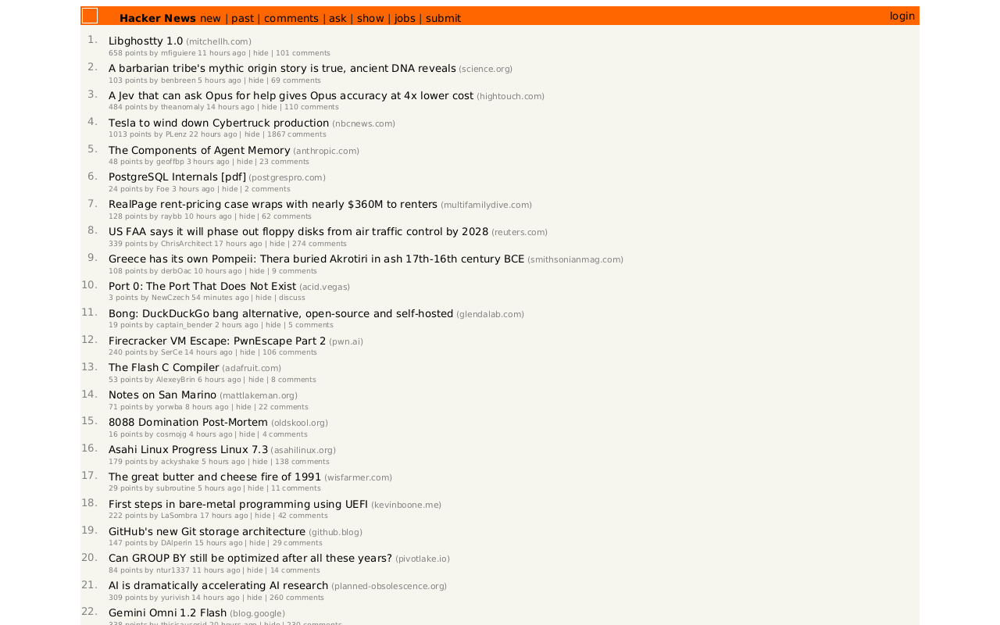

# Broxee

Broxee is a web browser with its own engine, written in Rust. Hard budget: **under 60 MB** for the app on disk and for RAM on simple pages.

## Screenshots

Rendered by Broxee itself with `--png` at 1280x800 (fonts: DejaVu Sans on Linux), no other browser involved.

| Wikipedia (15.7 MB peak RAM) | Hacker News (14.0 MB peak RAM) |
|---|---|
|  |  |

```bash
cargo run --release -- https://en.wikipedia.org/wiki/Web_browser --png docs/screenshots/wikipedia.png --width 1280 --height 800 --scale 1
cargo run --release -- https://news.ycombinator.com --png docs/screenshots/hacker-news.png --width 1280 --height 800 --scale 1
```

## Download

Prebuilt binaries are on the [Releases](https://github.com/kikiraihan/broxee/releases) page: macOS (arm64,
x86_64) and Linux (x86_64, CLI only for now). They are not signed; on macOS run
`xattr -d com.apple.quarantine broxee` after extracting, then `./broxee https://example.com --window`.

A release is built by `.github/workflows/release.yml` when a `v*` tag is pushed:

```bash
git tag v0.1.0
git push origin v0.1.0
```

Without pushing a tag: Actions > Release > Run workflow, with the tag name. A new tag is created on the latest
commit of the default branch when the release is published.

## Run

```bash
cargo run --release -- https://example.com --window    # open it in a window (macOS)
cargo run --release -- --window                        # bring back the last session
cargo run --release -- a.com b.org --window            # one tab per address
cargo run --release -- https://example.com --png out.png --scale 2   # render to an image
cargo run --release -- https://example.com --tree      # fetch, parse, print the DOM tree
cargo run --release -- https://example.com --styles    # the tree with computed styles
cargo run --release -- https://example.com --layout    # every box and line with its position
cargo run --release -- page.html --width 400           # local files, any viewport width
cargo test
```

Every run prints fetch, parse, CSS, cascade, layout and paint timings plus peak RAM, so budget regressions show
up immediately. `--no-css-fetch` skips external stylesheets; `--paint` paints without writing a file.

In the window:

| Action | Keys or mouse |
|---|---|
| Palette: open tabs (every profile), this profile's history, commands, a typed address | ⌘K or "Search or go to" in the sidebar; type to filter, ↑ ↓ or Tab, Enter, Esc |
| Scroll | trackpad or wheel, ↑ ↓, Space / Shift+Space, Page Up / Page Down, Home / End |
| Follow a link | click it |
| Fill in a form | click a field or Tab to it; type, paste, ← → Home End Backspace; Enter submits (in a text area it adds a line); Space checks a box, picks a radio button or presses a button; ↑ ↓ change a select; Esc leaves the field |
| Back / forward / reload | the header buttons, or ⌘[ / ⌘] / ⌘R |
| Stop loading | Esc, or the × that replaces reload while a page loads |
| Page menu: copy the address, open in another profile, bookmark, reload, close | ⋯ at the right of the header, or Tab to it and Enter; ↑ ↓ Enter, Esc |
| Tooltips | rest the pointer on a button or a sleeping tab for 0.6 s |
| New tab (opens the palette) / close tab / reopen closed tab | ⌘T / ⌘W / ⌘⇧T, or "+ New tab" and the × on the active row |
| Go to tab 1 to 8, the last tab | ⌘1 … ⌘8, ⌘9, or click the row (in the order shown: pinned, groups, the rest) |
| Pin a tab, move it to a group, fold a group | palette: "Pin or unpin this tab", "Move this tab to a group" (an empty name takes it out), "Fold or unfold this tab's group"; or click a group's label to fold it |
| Reorder tabs | drag a row; dropped under a label, it joins that section |
| Scroll the sidebar, resize it | the wheel over it; drag its right edge (200 to 320 points) |
| Switch profile | ⌘⇧P (cycles), a click on the profile name at the top of the sidebar, or "Switch to …" in the palette |
| Add, rename, recolor or remove a profile | palette: "New profile", "Rename this profile", "Change this profile's color", "Remove this profile" (asks for its name; its tabs, history, cookies and bookmarks are deleted) |
| Show or hide the sidebar | ⌘\\ |
| One pane, two side by side, four in a grid | ⌘⇧1 / ⌘⇧2 / ⌘⇧4, or `--panes 2` with several addresses; click a pane to give it focus. Each pane keeps its own profile |
| Bookmark this page (or edit its bookmark) | ⌘D: name and folder, the last folder preselected; Tab between them, Enter saves, Esc cancels |
| Bookmarks panel, in place of the tab list | ⌘⌥B: folders in name order; ↑ ↓ and Enter or a click opens, Esc goes back to tabs. Every bookmark is a ⌘K result too |
| Address field | ⌘L or click the host; type or paste (⌘V), Enter to open, Esc to cancel |
| Move between header controls and the page's links | Tab / Shift+Tab (a 2px ring marks the focused link; the page scrolls to it), Enter to activate or follow, Esc to leave |
| Quit | ⌘Q or close the window |

Tabs and profiles:

- Pages load on their own thread while the current page stays on screen: scrolling, links, tabs, profiles and
  the address field keep working. Opening another page, switching tab or switching profile stops the load (one
  page is built at a time, for memory); the tab stays on the page it showed.
- Each profile has its own tabs, history, closed tabs and **cookies**, so a login in Work never reaches
  Personal. Switching profile closes every idle connection and forgets TLS sessions, so a server cannot link
  the two through a reused connection either.
- Cookies follow RFC 6265bis: `Domain`, `Path`, `Expires`, `Max-Age`, `Secure`, `HttpOnly`, `SameSite`
  (Lax by default; Strict cookies stay behind on links from other sites; None needs Secure) and the
  `__Secure-` / `__Host-` prefixes. **Third-party cookies are blocked**: a subresource from another site
  neither sends nor sets them. A site cannot set a cookie for a public suffix (`co.uk`, `github.io`): the
  Public Suffix List is built in (below). Persistent cookies are saved per profile in
  `~/Library/Application Support/Broxee/profiles/<profile>/cookies` (0600, written atomically); session cookies
  never touch the disk. "Clear this profile's cookies" is in the palette. Limits: 4 KB per cookie, 60 per
  site, 3,000 per profile.
- Only the visible tab is a live page. The others sleep: the HTML and stylesheets as they arrived (usually
  Brotli or gzip) and the compressed images go to a private file in `~/Library/Caches/Broxee/tabs` (folder
  0700, files 0600). Selecting the tab rebuilds it from that file, without the network, at its old scroll
  position: 5 ms for MDN's home page, about 45 ms for GitHub. Sleeping tabs use no page memory, however many
  there are. The files total at most 256 MB; past that the tabs seen longest ago keep only their history and
  reload when selected. The folder is removed on exit, or at the next start when the browser was killed.
- The session (profiles, tabs, history, scroll positions; no page contents) is written to
  `~/Library/Application Support/Broxee/session` after each change. On start every tab comes back asleep and
  only the visible one loads.

## Written from scratch

Everything is written in this repository against the operating system's own interfaces, with one
exception: **TLS** uses `rustls` (and its `ring` crypto backend), because hand-written cryptography puts users
at risk, with `webpki-roots` (Mozilla's list of trusted certificate authorities, as data). Everything else in
`Cargo.lock` comes in through those two: `libc`, `getrandom` and friends at run time, `cc` only to build
`ring`.

The window layer calls AppKit through the Objective-C runtime (`objc_msgSend`) and shows frames through
`IOSurface`; process memory is read with a hand-declared `getrusage`.

Data taken from elsewhere, as data: the Brotli dictionary and tables (RFC 7932, CRC-checked in tests) and the
**Public Suffix List** (publicsuffix.org, Mozilla Public License 2.0), stored as
`crates/net/src/public_suffix_list.gz`: its 10,406 rules, punycode for internationalised labels, 46 KB in the
binary and about 150 KB in memory once a cookie first needs it. `scripts/update-public-suffixes.sh`
refreshes it. **Figtree** (SIL Open Font License 1.1), the interface font, is stored as its two WOFF2 files
(46 KB) in `crates/font/src/figtree/` and decoded by Broxee's own WOFF2 decoder.

## Crates

| Crate | Role | Status |
|---|---|---|
| `flate` | DEFLATE, zlib and gzip decoding, Brotli decoding (RFC 7932, with its static dictionary), checksums and an output cap; CRC-32 (ARMv8 instructions when present), Adler-32 | ✅ |
| `net` | URL parsing/joining, HTTP/1.1 over TCP, keep-alive connection pool, chunked and gzip bodies, redirects, `file://`, one retry on a reset or stale connection | ✅ |
| `html` | Tokenizer, entity decoding, tree builder with implied end tags, chunked arena DOM of 28-byte nodes | ✅ |
| `css` | Parser, `@media`, selector matching, cascade, computed styles, custom properties, grid values | ✅ |
| `font` | TrueType/OpenType reader: advances, vertical metrics, cmap formats 4 and 12, `.ttc`, glyph outlines (simple and composite); WOFF and WOFF2 (Brotli, with the `glyf`/`loca`/`hmtx` transforms rebuilt); face matching by family, weight and style with fallback per character | ✅ |
| `layout` | Block, inline, inline-block, flex and grid layout, positioning, line breaking, white-space, text-align, baselines | ✅ |
| `paint` | Display list, anti-aliased glyph rasterizer, glyph cache, image cache with parallel decoding, parallel band compositing, streaming PNG writer | ✅ |
| `image` | PNG (all color types and depths, `tRNS`, Adam7), JPEG baseline and progressive (any subsampling, restarts, Adobe RGB) with a scaled inverse DCT, GIF (first frame, interlaced, transparency), WebP lossy, lossless, alpha and the first animation frame, and an SVG subset rasterized at the drawn size; all decoded straight to the drawn size | ✅ |
| `platform` | macOS window, menu, app delegate, main-thread hand-off, zero-copy frames through `IOSurface` | ✅ (macOS) |
| `js` | JavaScript interpreter: lexer, parser, tree-walking evaluation over a per-page arena heap with step and object limits; builtins (Object, Array, String, Number, Math, JSON, Map, Set, RegExp with its own engine, Date, timers, console, storage) and DOM bindings (querySelector, textContent, innerHTML, classList, style, attributes, tree changes, addEventListener, form values) | ✅ (first milestone) |
| `shell` | The `broxee` binary: CLI, the page pipeline (`engine.rs`), the browser (`browser.rs`: history, navigation, scrolling, links, address field), form controls and submission (`forms.rs`) and its header (`chrome.rs`) | ✅ |

How the stages run (sequential, parallel, which thread) is documented in [`docs/pipeline.md`](docs/pipeline.md).

Pages are drawn in their own `@font-face` fonts, then Arial (macOS) or DejaVu Sans (Linux), character by
character; Broxee's interface uses Figtree (bundled, see `DESIGN.md`). Characters none of those have fall back
to the system's symbol font (macOS `Keyboard.ttf` for ⌘ ⇧ ⌥). Without a page font, pages use Figtree; tests use
a fixed half-em approximation.

Web fonts: only the faces that some text on the page uses are fetched (rust-lang.org declares 45 and loads 4),
each from the first `src` that loads, after the cascade and before layout. A page may load 24 faces of up to 4 MB
each, holding at most 8 MB together. Fonts are kept as they arrived with the page's sources, so a sleeping tab
wakes with them. Not yet: CFF outlines (`.otf` and CFF-flavored WOFF2 fall back to the next font), variable
font axes (the default instance draws), synthetic bold and italic, `font-display` (text waits for its fonts),
fonts for text that scripts add after loading.

## Layout support

| Supported | Not yet |
|---|---|
| Block boxes: width, height, min/max, `margin: auto`, percentages, padding, borders, `box-sizing`, `<center>` centering narrower blocks | margin collapsing through parents |
| Floats: `float: left`/`right` (shrink-to-fit, stacking, moving down until they fit), `clear` and `<br clear>`, `align=left`/`right` on images and tables, lines shortened beside floats, `display: flow-root`, `overflow` other than `visible`, inline blocks, flex and grid items and table cells sitting beside floats and holding their own | floats painting under later blocks' backgrounds (they paint in document order), line height other than the container's when testing room beside a float |
| Tables: automatic column widths from cell content, px and % cell widths, `colspan`/`rowspan`, `thead`/`tfoot` order, rows and cells without their wrappers, `border-spacing`, row backgrounds, `vertical-align` top/middle/bottom, `inline-table`, `caption-side`, non-table content in anonymous cells | `table-layout: fixed`, collapsed border drawing, `<col>` widths, bottom captions |
| Grid: track lists (lengths, %, `fr`, `auto`, `min-content`, `max-content`, `minmax()`, `fit-content()`, `repeat()` with `auto-fill`/`auto-fit`), `grid-template-areas` and `grid-area`, line numbers and `span`, sparse auto-placement, implicit tracks, gaps, `align-self`, `order` | column auto-flow and `dense`, named lines, `justify-items`/`-self`, `align-content`/`justify-content`, subgrid, intrinsic size of a grid container |
| Flex: rows and columns (and reverses), wrapping rows, grow/shrink/basis with min/max and automatic minimums, auto margins, `justify-content`, `align-items`/`align-self`, `gap`, `order`, text as anonymous items | `align-content`, wrapping columns, baseline alignment (as start), cross-axis auto margins |
| `inline-block` and `inline-flex`: shrink-to-fit, unbreakable on the line, aligned on their last baseline | `vertical-align` |
| `position: relative` (shifts the box and its content), `absolute` (against the nearest positioned ancestor, insets, shrink-to-fit width, static position when no inset), `fixed` (stays put while scrolling, no scroll height); `z-index` on positioned boxes, relative ones included, ordering their layers (the outermost stacking context's z-index, then the box's own), and clicks follow the same order | stacking contexts deeper than two levels, negative `z-index` painting above the root background, `sticky` (treated as relative) |
| `overflow: hidden`/`clip` clips descendants to the padding box, to its rounded corners with `border-radius`; `visibility: hidden`; `opacity`, the element and its content blended as one group | scrolling inside boxes (`auto`/`scroll` show everything); positioned descendants of a translucent or rounded box are drawn outside its group |
| Sibling margin collapsing | collapsing through parents and empty boxes |
| Anonymous blocks around inline runs; an inline holding a block becomes a block | |
| Line breaking, collapsed white space, `pre`, `nowrap`, `pre-wrap`, `<br>` | `justify`, hyphenation, bidi, `word-break`/`overflow-wrap` |
| Half-leading baselines, `line-height` normal/number/length | `vertical-align` outside table cells |
| Inline elements with margins, padding, borders and backgrounds (one box per line they span; plain inline elements cost nothing) | `box-decoration-break` (every piece draws all four borders) |
| `` as a replaced element: CSS size, `width`/`height` attributes, the file's natural size and ratio, `max-width` keeping proportions, in inline, block, flex and grid | `object-fit`, `<picture>`, `srcset` density selection (first candidate is used), `loading=lazy` |
| Scrollable height includes overflow, except what a box with `overflow` other than `visible` hides (the root's and `<body>`'s still scrolls, as browsers apply theirs to the viewport) | padding, borders and margins on inline elements |
| Changes from scripts, form controls and `:hover`/`:focus` lay out again only inside the nearest box that clips its overflow, sits in normal flow and keeps its size (typing in a field: the field); text-only changes skip the cascade unless a rule uses `:empty` | restyling only the changed subtree (the whole page is restyled, then compared); moving what follows a box whose height changed (the page is laid out again) |

TLS uses `rustls` (ring backend). Everything else is written here; crypto is the one thing we do not hand-roll.

## CSS support

| Area | Supported | Not yet |
|---|---|---|
| Selectors | type, `.class`, `#id`, `*`, attributes (`=`, `~=`, `\|=`, `^=`, `$=`, `*=`, `i` flag), `:root`, descendant, `>`, `+`, `~`, `:first-child`/`:last-child`/`:only-child`, `:nth-child()`/`:nth-last-child()`, `:not()` with simple arguments, `:checked`, `:disabled`/`:enabled`, `:empty`, `:link`, `:hover`, `:active`, `:focus`, `:focus-visible`, `:focus-within` | `:is()`/`:where()`/`:has()`, complex `:not()` arguments; `:visited`, `:target` and validation states never match (dropped) |
| Generated content | `::before`/`::after` (and `:before`/`:after`) with `content` as strings (escapes such as `"\f101"`), `attr()` and `none`; styled and laid out like any inline or block box | counters, quotes, `url()` in `content` (the declaration is dropped), `::marker`, `::first-line`, `::placeholder` |
| At-rules | `@media` (type, min/max width and height, range syntax, `calc(a ± b)`, `prefers-color-scheme`, orientation, reduced motion), `@supports` and `@layer` contents, `@font-face` (`font-family`, `src` with `url()` and `format()`, `font-weight` and its ranges, `font-style`, `unicode-range`; `data:` URLs) | `@container`, `@import`, `@keyframes` (skipped), `local()` sources |
| Properties | display (incl. `flex`, `inline-flex`), color, background(-color), font (with its family), font-family (and `<font face>`), font-size/weight/style, line-height, text-align, white-space, text-decoration, width, height, min/max, `box-sizing`, margin, padding, border (+ sides, width/style/color), position, inset (`top`/`right`/`bottom`/`left`), visibility, overflow, opacity (0 or visible), `outline` (+ `-width`/`-style`/`-color`/`-offset`), `border-radius` (+ the four corners, elliptical `a / b`, percentages), `box-shadow` (several, `inset`, blur, spread), `transform` (`translate`, `scale`, `rotate`, `skew`, `matrix` and their axis forms; 3D functions as identity) and `transform-origin`, `background-image` and `background` with `url()` images (relative to their stylesheet), `linear-gradient`/`radial-gradient` and their `repeating-` forms, layered; `background-size` (`cover`, `contain`, lengths), `background-position`, `background-repeat` (`repeat-x`/`-y`, `no-repeat`; `space` and `round` repeat) (angles, `to` sides and corners, radial shapes, sizes and `at`, stops with one or two positions), flex-direction/-wrap/-flow, justify-content, align-items/-self, flex/-grow/-shrink/-basis, gap/row-gap/column-gap, order, `vw`/`vh`/`vmin`/`vmax` | everything else, `light-dark()`, `calc()` in property values, 3D transforms, `background-size`/`-position`/`-repeat` per layer (the first layer's apply to all), positions with edge offsets (`right 10px top 20%` uses the edges), gradients sized by `background-size`, `background-attachment`, `background-clip`/`-origin`, `conic-gradient`, gradient color hints (skipped), outlines following `border-radius` |
| Grid | `display: grid`/`inline-grid`, `grid-template-columns`/`-rows`/`-areas`, `grid-template`, `grid` (template forms), `grid-auto-rows`/`-columns`/`-flow`, `grid-row`/`-column` (+ `-start`/`-end`), `grid-area` | `grid: auto-flow ...`, `span <name>`, `<name> <n>` |
| Custom properties | `--name` declarations (inherited), `var(--name, fallback)` in any property including shorthands, nested `var()`, cycle detection, inline `style` variables | `@property` |
| Cascade | UA → presentational hints (`bgcolor`, `width`, `align`, `valign`, `cellpadding`, `cellspacing`, `border`, `<font color size>`, `nowrap`) → author → inline, specificity, order, `!important`, inheritance, `inherit`/`initial`; quirks-mode table reset for documents without a doctype | cascade layers order, `unset` treated as `initial` |

Rules that cannot match are not kept: before stylesheets are parsed, the DOM's tags, ids and classes are
collected, and a rule whose every selector needs a name the page lacks is skipped without parsing its
declarations. Sites ship CSS for all their pages; GitHub's home page uses 7% of its 30,309 rules. Computed styles
on GitHub, Wikipedia, Hacker News and MDN were compared node by node with and without this: identical.

Speed tricks, the same ones production engines use: rules bucketed by id/class/tag, a counting bloom filter of
ancestor tags/ids/classes that rejects most descendant selectors without walking the tree, style sharing between
identical siblings, and deduplicated computed styles (each node stores a 4-byte style index). `:root`-only rules
have their own bucket so other elements never test them. A computed style depends only on the parent's style,
the matched rules and the `style` attribute, so elements without the attribute that match the same rules under
the same parent style reuse the result instead of computing and hashing a new one.

Custom properties cost nothing on pages without them. Sites that use them (GitHub declares about 20,000) are
kept cheap three ways: variable sets form a chain that borrows the strings from the stylesheet, a set is shared
by every element that matched the same rules under the same parent, and a variable is resolved only the first
time something reads it (most theme variables never are). A `var()` value is substituted and parsed once per
(declaration, variable set) and then reused.

## Roadmap

1. ✅ Networking
2. ✅ HTML → DOM
3. ✅ CSS parser + selector matching + cascade
4. ✅ Layout: block, inline, text wrapping
5. ✅ Painting to a window: the first visible page
6. ✅ Scrolling, links, back/forward, address bar
7. ✅ JavaScript, written here (not Boa: no engine crate, the owner's rule) + a subset of the DOM API
8. Product features: ✅ profiles, ✅ tabs that sleep to disk, ✅ session restore, ✅ ⌘K palette, ✅ cookies,
   ✅ bookmarks, ✅ tab groups, ✅ split view, ✅ forms

## Budget log

`./scripts/budget.sh` enforces it; `make check` runs it with fmt, clippy and tests.

| Date | Change | Binary | Stress page (2.6 MB, 360k nodes) | Wikipedia article (407 KB, 7,680 nodes) |
|---|---|---|---|---|
| 2026-11-06 | First DOM (Vec children, owned strings) | 1.3 MB | 55.8 MB peak, 24 ms parse | 12.9 MB peak, 4.6 ms parse |
| 2026-11-06 | Linked children, u32 ids, interned names, borrowed tokens | 1.3 MB | 27.0 MB peak, 19 ms parse | 11.7 MB peak, 4.6 ms parse |
| 2026-11-06 | CSS: parser, `@media`, cascade with bloom filter and style sharing | 1.4 MB | 27.3 MB peak, 45 ms cascade (with a `<style>` block) | 13.6 MB peak, 476 rules, 5.7 ms cascade |
| 2026-11-06 | Layout: blocks, lines, fonts; 24-byte text runs, reserved box list | 1.4 MB | 37.0 MB peak (47 MB before slimming fragments) | 14.3 MB peak, 1.2 ms layout, 11,294 px tall |
| 2026-11-07 | Paint, window, parallel CSS fetch; budget now paints at 2x; chunked DOM and text lists | 1.5 MB | 58.3 MB peak painted at 2x (42.4 MB without paint) | n/a |
| 2026-11-07 | 28-byte DOM nodes; text and attribute values in shared buffers | 1.5 MB | 48.7 MB peak painted at 2x (32.8 MB without paint), parse 16 ms | 14.7 MB peak |
| 2026-11-07 | Browsing: scroll, links, history, address field, header, double-buffered frames | 1.5 MB | 48.8 MB peak painted at 2x | n/a |
| 2026-11-07 | CSS: sibling combinators, `:nth-*`, `:not`, states, attribute operators, positioning, overflow clips, visibility, custom properties | 1.6 MB | 48.8 MB peak painted at 2x | 29.4 MB peak, 8.7 ms cascade, 716 rules |
| 2026-11-07 | Flex, inline-block, box-sizing; matched-rule style cache, word-at-a-time hasher, allocation-free child walks | 1.6 MB | 48.6 MB peak painted at 2x; cascade 48 → 16 ms, layout 18 → 12 ms | 29.2 MB peak, 6.8 ms cascade |
| 2026-11-07 | Grid; fetched stylesheets parsed in their own buffer with comments blanked in place | 1.6 MB | 48.6 MB peak painted at 2x | 15.3 MB peak unpainted, 1.3 to 2.3 ms layout |
| 2026-11-07 | `flate` (inflate, gzip, zlib); keep-alive connections, gzip bodies, framed reads without copies | 1.7 MB | 48.6 MB peak painted at 2x | CSS 207 → 69 ms wall |
| 2026-11-07 | Images: `image` crate, decode-at-drawn-size, 8 MB pixel cache, streaming PNG writer | 1.7 MB | 48.8 MB peak painted at 2x | Cat article: 57 images (906 KB), 9 decoded at 2x, 39 MB peak |
| 2026-11-07 | Tables, presentational hints, quirks mode; rules that cannot match the document skipped at parse time | 1.8 MB | 49.2 MB peak painted at 2x; layout 12.6 ms | GitHub: 28,170 of 30,309 rules skipped, 43.7 → 25.3 MB unpainted, 60.2 → 40.5 MB painted at 2x |
| 2026-11-07 | Inline boxes; attribute-aware rule pruning; window fitted to screen, spare surface released when idle | 1.8 MB | 49.2 MB peak painted at 2x | window: GitHub 43 MB idle / 58 MB peak (was 74 MB peak) |
| 2026-11-07 | Progressive JPEG; scaled inverse DCT for every JPEG drawn smaller | 1.8 MB | 49.1 MB peak painted at 2x | 12 MP photo at 400 px: 15 to 18 MB peak, decode 21 to 32 ms |
| 2026-11-07 | Brotli; faster gzip (hardware CRC, exact output allocation, chunked copies) | 1.9 MB | 49.2 MB peak painted at 2x | gzip 237 → 478 MB/s; Brotli 400 to 690 MB/s |
| 2026-11-07 | Tabs that sleep to disk, profiles, session restore, sidebar | 2.0 MB | 49.3 MB peak painted at 2x | Window with four tabs: 60 to 61 MB peak (see below) |
| 2026-11-07 | Space-efficient malloc on macOS (#1) | 2.0 MB | 49.3 MB peak painted at 2x | Window: GitHub 58 → 48 MB peak, four tabs 61 → 46 MB, twelve pages in a row 47 MB |
| 2026-11-07 | Rules dropped from their selector text (#16) | 2.2 MB | 49.3 MB peak painted at 2x | GitHub's 30 sheets (3.4 MB): 15.0 → 11.7 ms, 155,109 → 34,167 allocations, same 820 rules |
| 2026-11-08 | Display list skips runs of fragments out of view (#17) | 2.2 MB | 49.4 MB peak painted at 2x | Stress page: display list 0.65 → 0.01 ms a frame at any scroll; layout +0.8 ms once to index |
| 2026-11-08 | Glyphs on quarter pixels (#18) | 2.2 MB | 49.5 MB peak painted at 2x | Repeated "i" at 13px, 1x: gaps 4/3/4/3 px (stdev 0.50) → 3.5 ± 0.15 px; GitHub glyph cache 46 → 88 KB |
| 2026-11-10 | GIF, WebP and SVG drawn (#14) | 2.4 MB | 49.4 MB peak painted at 2x | 4000x4000 lossy WebP at 400 px: 17.9 MB peak (empty page 16.7), 296 ms; 4000x3000 lossless: 20.5 MB, 154 ms |
| 2026-11-10 | Header in its own layer (#15) | 2.4 MB | 49.4 MB peak painted at 2x | Typing and the loading line paint a 36-point strip, not the 16 MB frame; GitHub load in a window: 37 MB idle, peak 48 to 54 MB, 0.3 s CPU (before: 37 MB, 51 to 53 MB, 0.3 s) |
| 2026-11-10 | Forms: controls, editing, GET and POST (#13) | 2.4 MB | 49.4 MB peak painted at 2x | Wikipedia's search form submits from the keyboard; a keystroke lays the page out again (no incremental layout yet) |
| 2026-11-10 | Split view, 1/2/4 panes (#7) | 2.4 MB | 49.4 MB peak painted at 2x | Window with GitHub, Wikipedia, HN, example.com: 1 pane 30 MB idle / 44 MB peak, 2 panes 33 / 47 MB, 4 panes 31 / 45 MB |
| 2026-11-10 | JavaScript, written here (#12) | 2.9 MB | 49.6 MB peak painted at 2x | example.com 20 MB, HN 22 MB, Wikipedia 27 MB, GitHub 32 MB peak with their scripts run; scripts that use unsupported syntax are skipped and logged |
| 2026-11-12 | Floats and clear (#23) | 2.9 MB (+16 KB) | 49.6 MB peak painted at 2x; layout 14.1 → 14.7 ms (+4%) | Rust article: infobox and thumbnails on the right with text beside them, 34.0 MB peak (unchanged) |
| 2026-11-12 | `::before`/`::after`, `:hover`/`:focus`/`:focus-visible`/`:focus-within`/`:active`, `outline` (#24) | 2.9 MB | 49.6 MB peak painted at 2x; layout unchanged | Cascade on saved copies (200 runs, minimum): Wikipedia 2.9 → 4.1 ms (it now matches its `::before`/`::after` rules on `a`, `span`, `li`), MDN 1.60 → 1.64 ms. A pointer move restyles only when a rule can see the change |
| 2026-11-13 | Web fonts: `@font-face`, WOFF/WOFF2, matching with fallback per character; Figtree bundled (#25) | 3.0 MB (3,071,888 → 3,171,088 bytes, +99 KB, Figtree 46 KB of it) | 49.6–49.7 → 49.7 MB peak painted at 2x; layout 14.7 → 15.6 ms (+6%, a bench of 300 layouts) | rust-lang.org: 4 of 45 faces (136 KB in memory, 31 ms). MDN: 2 of 13 faces, peak 22.6 → 24.0 MB. Font Awesome's site draws its icons (7 of 8 faces, 195 KB). Wikipedia (no web fonts): 24.3 → 24.6 MB |
| 2026-11-13 | `border-radius`, `box-shadow`, linear and radial gradients (part of #33) | 3.1 MB (3,171,088 → 3,220,768 bytes, +49.7 KB) | 49.7 → 49.8 MB peak painted at 2x; composite 1.30 → 1.32 ms (6 runs each, +1.5%) | GitHub repository page at 2x: composite 2.2 → 4.2 ms, its loading skeletons (translucent gradients over a third of the frame) now drawn; gradients use a 1,024-color table, axis-aligned ones copy rows, and corners alone cost per-pixel work |
| 2026-11-13 | Partial `opacity` as a group, `z-index`, children clipped to rounded corners (part of #33) | 3.1 MB (3,237,296 → 3,286,896 bytes, +49.6 KB) | 49.8 MB peak painted at 2x; composite 1.32 → 1.27 ms, layout 16.1 → 16.4 ms (5 runs each) | singapay.id at 2x: 6.8 → 8 to 10 ms, now drawing its translucent shapes behind its content and its fixed banner over the header (z-index 60 over 50); BBC 3.2 → 2.9 ms. Six other sites pixel-identical. Groups copy their backdrop 32 rows at a time and only within their bounds; most need none (a rounded clip whose content stays off the corners, opacity over a single item) |
| 2026-11-13 | 2D transforms, drawn and hit tested (part of #33) | 3.2 MB (3,286,896 → 3,303,456 bytes, +16.6 KB) | 49.6 MB peak painted at 2x; composite 1.34 → 1.23 ms, layout unchanged (5 runs each) | A transform that only moves is drawn by shifting; others render offscreen (at most 512K pixels a layer, 1M a frame) and are sampled through the matrix. Ancestors' clips stay put (a carousel's track). A page of rotated, scaled, skewed and tilted boxes: 4.2 ms at 2x, 21.6 MB peak. Eight sites pixel-identical |
| 2026-11-13 | CSS background images: `url()` layers with size, position and repeat (#33) | 3.2 MB (3,303,456 → 3,336,544 bytes, +33 KB) | 49.8 MB peak painted at 2x; composite 1.33 → 1.31 ms, layout unchanged (5 runs each) | Found after the cascade for displayed elements, fetched while web fonts load, kept by URL in the page's image budget and in sleeping tabs (tab file 4). Decoded at the tile's drawn size; a repeat is one item, however many tiles. Hacker News now shows its vote arrows, Wikipedia its small icons; six other sites pixel-identical |

| 2026-11-14 | Incremental layout after DOM changes (part of #26) | 3.4 MB (3,336,544 → 3,369,616 bytes, +33 KB) | 49.8 MB peak painted at 2x (unchanged) | Typing into a field above the stress page's 20,000 rows: 0.09 ms a key, against 38.4 ms for a full restyle and layout (release, `typing_cost_on_the_stress_page`). A box rebuilt alone matches a full pass exactly (1,600 random changes, 4 seeds). BBC is 14,041 → 12,633 px tall: a collapsed 1 px wide panel no longer adds its hidden text to the scroll height; seven other sites keep their height |

Other pages after the layout milestone: GitHub home 22.7 MB peak (8,170 rules); Hacker News 11.5 MB.

GitHub after custom properties: 39 MB peak, 24 ms cascade, 24,822 rules. Rules that only declare or use
variables used to be dropped as empty; keeping them grew the rule count 2.5x. The first version took 84 ms and
49 MB. Lazy resolution, sets shared per matched-rule list, a `:root` bucket, unsorted candidate lists and
trimming spare `Vec` capacity in parsed rules (6 MB alone) brought it to the numbers above.

Window mode on a Retina display, measured with `footprint` (what Activity Monitor shows), 2026-11-07, sidebar
shown:

| Page | Idle | Peak | Before space-efficient malloc |
|---|---|---|---|
| example.com | 28 to 29 MB | 44 to 45 MB | 33 / 49 MB; baseline: AppKit, fonts, one 16 MB frame surface |
| GitHub | 31 MB | 48 MB | 44 / 58 MB |
| Wikipedia "Cat" | 30 MB | 46 MB | 40 / 55 MB |
| Tabs: Wikipedia, MDN, example.com asleep, GitHub visible | 30 MB | 46 MB | 45 / 61 MB |
| Tabs: GitHub, MDN, example.com asleep, Wikipedia visible | 29 MB | 47 MB | 45 / 60 MB |
| 12 heavy pages built in a row (GitHub, Wikipedia, MDN, Hacker News, BBC, rust-lang.org, ...) | 29 MB | 47 MB | not measured; 11 sleeping tabs are 9.3 MB on disk |

Two fixes got there. The window asked for 1280 points; macOS shrank it to fit the screen after the first frames,
which rebuilt every surface while the old one was still on screen (74 MB peak on GitHub). The window is now
fitted before it is shown. And the spare surface of the double buffer is released after a second without
events (16 MB at Retina size); the next frame recreates it. Peaks happen while drawing, when both surfaces
exist. Releasing freed allocator pages (`malloc_zone_pressure_relief`) after loading changed nothing measurable:
what remains is live data and fragmentation.

**Space-efficient malloc (issue #1).** Before it, a session that had built a heavy page peaked at 60 to 61 MB
even with every other tab on disk. After GitHub, then example.com, `heap` counted 6.8 MB of live allocations
while `MALLOC_SMALL` held 19 to 25 MB of dirty memory: freed blocks macOS malloc keeps in its per-CPU caches.
`malloc_zone_pressure_relief` and skipping progress frames changed nothing. Starting the process with
`MallocSpaceEfficient=1` did: 43 → 29 MB idle and 59 → 48 MB peak for that sequence, with parse, cascade,
layout and paint times unchanged (stress page and saved GitHub, three runs each) and CLI peak RAM unchanged.
libmalloc reads the variable only at process start, so `broxee` re-executes itself once with it set (about
10 ms). It is not in `man malloc`: if a macOS release ignores it, memory returns to the old numbers and nothing
else changes. Setting it yourself (`MallocSpaceEfficient=0` to compare) skips the restart.

Earlier: Hacker News 48 MB with double buffering,
of which 31 MB are the two 2560x1600 Retina frames. A third buffer appeared during loading (63 MB) until the
pool was capped at two. Showing frames as a `CGImage` first cost 63 MB for a near-empty page because the
frame existed three times; painting straight into an `IOSurface` removed both copies.

JPEGs drawn smaller than they are decode at k/8 of their size (k = 1, 2, 4 or 8) with a k-point inverse DCT,
as libjpeg's `-scale` does, and subsampled chroma with a larger one so nothing is upsampled. A 12-megapixel
photo shown 400 px wide: baseline 172 → 21 ms; progressive 32 ms, 18 MB peak for the whole process.
Progressive files keep only the k x k coefficients they need plus a 64-bit non-zero mask per block (refinement
scans need it), instead of 36 MB of coefficients; one decodes at a time.

Images never exist at full size: a decoder hands rows to a box filter that shrinks them to the size they
are drawn at, PNG data streams through a 32 KiB inflate window and JPEG is decoded one row of blocks at a
time. GIF rows come straight out of LZW (interlaced frames are assembled at one byte per pixel first, as
interlaced PNGs are), lossy WebP is decoded one macroblock row at a time with the loop filter one row
behind, and lossless WebP keeps a ring of the last million pixels, the farthest a backward reference can
reach, so a 4000x3000 file costs about 4 MB to decode instead of 48. SVG is rasterized at the drawn size with
one row of coverage. Only images in view are decoded (in parallel); decoded pixels live in a 8 MB cache that evicts what
has not been drawn recently, and the page keeps only compressed bytes (12 MB cap). The debugging PNG writer
used to hold three copies of a frame (69 MB for a 1280x3000 render); it now writes rows straight into the
file (48 MB).

Parallel stylesheet loading: GitHub's 28 stylesheets went from 3.5 s (one after another) to about 0.75 s wall.
Reusing connections and accepting gzip then took it to 0.23 s: the 28 requests no longer pay 28 TLS handshakes,
and 3.3 MB of CSS arrives as about a sixth of that.

Timings taken right after network waits are inflated: on Apple Silicon the CPU clocks down while idle, so
GitHub's cascade measures 10 ms just after its stylesheets download and 2.8 ms when warm (same code, same
rules). Compare warm numbers when hunting regressions.

## Compression

Where data lives, and what compression does for it (measured 2026-11-07):

| Where | Decision | Why |
|---|---|---|
| Network | `Accept-Encoding: br, gzip, deflate`; Brotli decoder written here | Brotli is what CDNs serve: GitHub's CSS 14.4 → 7.1 KB, Cloudflare's page 301 → 155 KB, Wikipedia's HTML (re-encoded) 249 → 181 KB. Decodes at 400 to 690 MB/s, faster than our gzip was. |
| Network | No zstd decoder | None of GitHub, Wikipedia, Hacker News, MDN, Cloudflare, NYT or BBC offered it. Nothing to save yet. |
| CPU | gzip 6.5 → 3.3 ms for Wikipedia's 1.5 MB page (237 → 478 MB/s) | Profiling showed the CRC check and match copies, not decoding, dominated: CRC-32 now uses ARMv8 instructions (slicing-by-8 elsewhere), output is allocated once from gzip's size trailer, and short matches copy in 8-byte chunks. |
| Memory: images | Keep compressed files; decode only what is on screen, at its drawn size | Re-decoding from the file is the cheapest compressed form: 1 to 30 ms even for a 12 MP photo. A compressed pixel cache would add code and save little. |
| Memory: page | Not compressed while open | Layout and paint read text and styles constantly; compressing them would cost every frame. |
| Memory: tabs | A sleeping tab is its sources as received plus compressed images, in a file on disk | GitHub 2.5 MB (92 KB of gzip HTML, 712 KB of CSS, 1.75 MB of images), Wikipedia "Cat" 1.2 MB, MDN 57 KB. Waking takes 5 to 45 ms without the network. In RAM, even a few of them would fill the headroom under 60 MB. |
| Disk: binary | Keep `opt-level = 3` | `"s"` saves 0.31 MB (1.95 → 1.64) but layout is 55% slower and cascade 25%; `"z"` is 3x slower. |
| Disk: caches (later) | Store responses in the encoding they arrived in | No re-compression work, and already the smallest form. |

## Known issues

- No table layout and no presentational attributes (`bgcolor`, `align`): Hacker News renders centred without its
  orange bar.
- The palette cannot search the web: with no search engine chosen, a query that matches nothing says
  "Broxee can't search the web yet." Bookmarks will join its results when they exist.
- Figtree has no ⌘ ⇧ ⌥: they come from the system's symbol font, and the chrome draws them as icons on systems
  without one.
- Bookmarks cannot be imported from other browsers yet, and folders are flat (no folders inside folders).
  They are saved per profile in `profiles/<profile>/bookmarks` (0600).
- Sidebar rows have no keyboard focus of their own: tabs are reached with ⌘1 … ⌘9 and the palette, which
  also runs every sidebar action. Dragging needs the mouse.
- Split view: panes are not saved with the session yet, the tab list does not mark which tabs are in a pane,
  and tabs cannot be dragged onto a pane. A pane that has not had focus since the layout changed shows its
  tab's title until it is clicked.
- A tooltip can stay on screen when the pointer leaves the window over it, until the next input: the
  window does not track the pointer leaving yet.
- Profiles start as Personal and Work; up to 12, each with its own folder in `profiles/` (named by a fixed
  id, so renaming moves nothing). Four colors exist (emerald, amber, rose, violet), so profiles past four
  share them; their names always tell them apart.
- Forms: text fields, passwords, text areas, checkboxes, radio buttons, selects (↑ ↓ or a click steps
  through the options; no dropdown list yet) and buttons; GET and POST as
  `application/x-www-form-urlencoded` (multipart and file uploads are not sent). Long values are clipped at
  the field's edge instead of scrolling. Typed values live with the page: a tab that sleeps forgets them, and
  passwords are never written to disk.
- JavaScript: classic scripts (inline and `src`) run; modules, classes, generators, getters and setters,
  promises, `fetch` and `XMLHttpRequest` do not. A script using unsupported syntax is skipped as a whole and
  the reason goes to stderr (`console:`), with what scripts log. Events: `click` (bubbling, `preventDefault`,
  `onclick` attributes and properties), `DOMContentLoaded`, `load`; timers and `requestAnimationFrame`. Every
  DOM change restyles and lays out the whole page.
- GIF animations and animated WebP show their first frame. SVG draws shapes, strokes, `use`, simple `<style>`
  rules and transforms; gradients are drawn as the average of their stops, and text, filters, masks and clip
  paths are skipped. Failed images draw nothing.
- Painting will add a window framebuffer (about 16 MB at 2x for 1280x800). The stress page sits at 37 MB, so
  paint must stay within roughly 20 MB including glyph caches.
